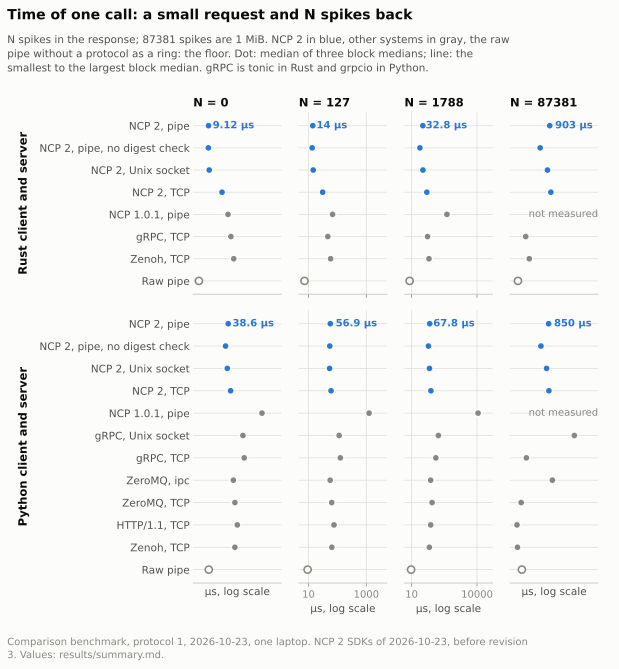
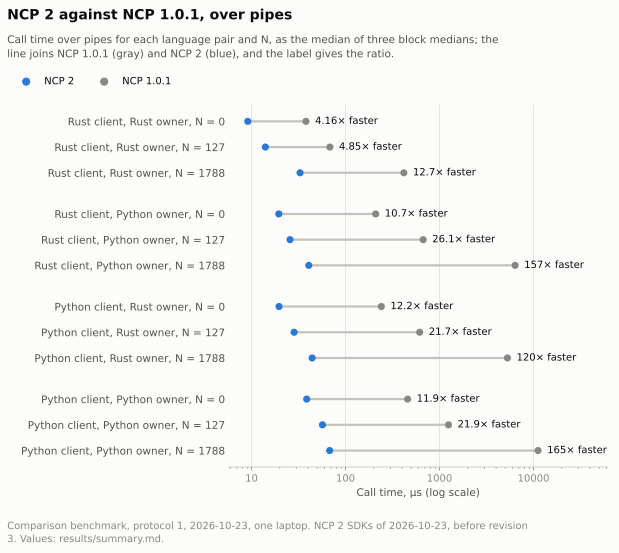
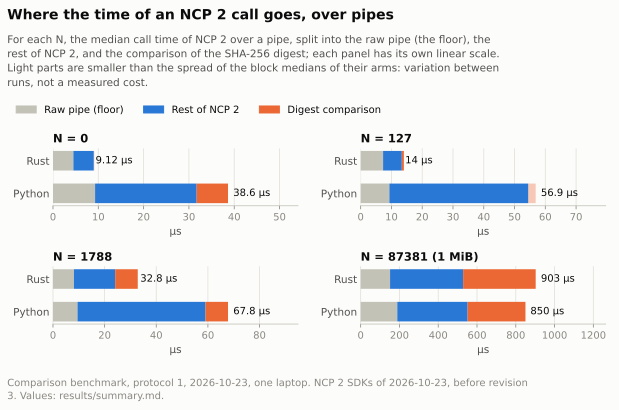
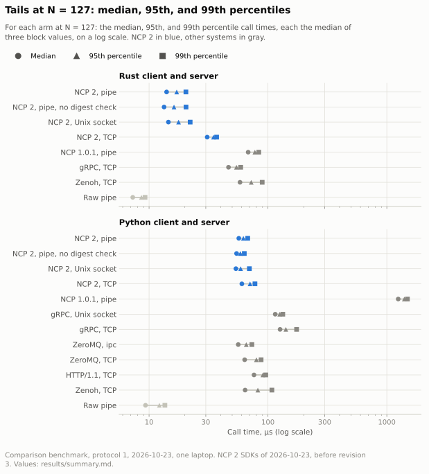
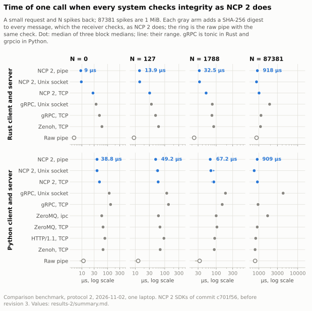
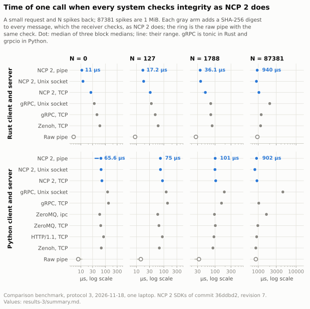
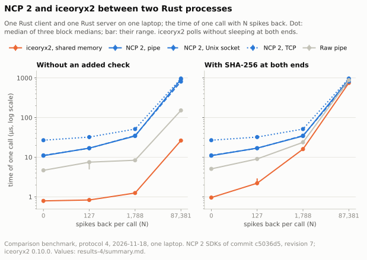

# Comparison benchmark

How long one call takes with NCP 2, with NCP 1.0.1, and with other ways for two programs on one computer to exchange a request and a response: gRPC, ZeroMQ, Zenoh, HTTP/1.1, and a raw pipe without a protocol.

The [protocol](PROTOCOL.md) was fixed before the timed runs (SHA-256 `e711a417…`, in [`PROTOCOL.sha256`](PROTOCOL.sha256)).
It fixes the workload, the 24 arms, the design, the validity checks, the hypotheses with their decision rules, and the analysis.
The validity checks passed: the Rust and Python tests, the shared conformance vectors, the model conformance of both owners, differential fuzzing of 200,000 frames, and a short run of every configuration.
The 276 timed runs ran on 23 October 2026 from 18:28 to 18:37 UTC, three blocks in a shuffled order, on an Apple MacBook Pro (Mac16,5, M4 Max) with macOS 26.5.1, Rust 1.99.1, and Python 3.15.0, on battery power in High Power Mode.
No run failed. Other programs were running: the one-minute load average before a run was 2.8 to 5.3.

Each call sends a small request and gets N spikes back, 12 bytes each.
Each value is the median of the three block medians; ranges are the smallest and largest block median.
All values are in [`results/summary.md`](results/summary.md).

<a href="results/figures/calls_light.svg">
<picture>
  <source media="(prefers-color-scheme: dark)" srcset="results/figures/calls_dark.svg">
  
</picture>
</a>

## Hypotheses

All five hypotheses hold in every block.

| # | Hypothesis | Result |
| --- | --- | --- |
| H1 | NCP 2 is faster than NCP 1.0.1. | 4.2 to 165 times faster, in all 12 comparisons of language pair and N. |
| H2 | NCP 2 meets its design targets. | Rust client and owner: 9.1 µs (target 15 µs). Python client and owner: 38.6 µs at N = 0 and 56.9 µs at N = 127 (target 150 µs). |
| H3 | NCP 2 adds little to the floor. | 4.6 µs more than the raw pipe at N = 0 (limit 10 µs). |
| H4 | In Rust, NCP 2 is faster than gRPC and Zenoh. | 10 of 10 comparisons. At N = 127: 14.0 µs over a pipe and 30.8 µs over TCP, against 46.6 µs for gRPC (tonic) and 58.2 µs for Zenoh. |
| H5 | In Python, NCP 2 is faster than gRPC and HTTP. | 9 of 9 comparisons. At N = 127: 56.9 µs, against 115.1 and 126.5 µs for gRPC (grpcio, Unix socket and TCP) and 76.3 µs for HTTP/1.1. |

<a href="results/figures/versions_light.svg">
<picture>
  <source media="(prefers-color-scheme: dark)" srcset="results/figures/versions_dark.svg">
  
</picture>
</a>

The two versions differ in three ways that affect this time: NCP 2 needs one round trip for each call instead of two, sends spikes as typed arrays instead of JSON lists, and hashes the exact frame bytes instead of a canonical form. The benchmark measures their sum, not each one alone. The ratio grows with N, as expected when NCP 1.0.1 encodes every spike as JSON numbers.

## Exploratory results

These questions had no hypothesis.

- **Python, against ZeroMQ and Zenoh.** NCP 2 is faster at N = 0 (38.6 µs; ZeroMQ over `ipc` 56.2 µs, Zenoh 62.8 µs) and about equal at N = 127 (56.9 µs, range 48.0 to 64.6; ZeroMQ 56.2 µs; Zenoh 64.2 µs) and at N = 1788 (67.8 µs; Zenoh 65.3 µs; ZeroMQ 74.9 µs). NCP 2 also checks every frame and gives exactly-once execution; the others do neither.
- **Tails.** At N = 127, NCP 2 has the lowest 99th percentile in each language: 20.4 µs in Rust over a pipe (gRPC 59.0 µs, Zenoh 89.5 µs) and 67.6 µs in Python (ZeroMQ 73.2 µs, HTTP/1.1 95.9 µs, Zenoh 108.0 µs, gRPC 174.2 µs).
- **Connections.** For small frames, a Unix domain socket costs about the same as a pipe; TCP adds about 15 µs in Rust at N = 0. At 1 MiB, the Unix domain socket is faster than the pipe (797 against 903 µs in Rust), because a pipe on macOS moves at most 64 KiB at a time.
- **1 MiB.** NCP 2 is slower than the arms without an integrity check: in Rust, 903 µs over a pipe against 234 µs for gRPC and 287 µs for Zenoh; in Python, 850 µs against 144 µs for HTTP/1.1 and 148 µs for Zenoh. Without the receiver's digest comparison, which specification section 3, rule 4 allows on pipes and Unix domain sockets with no program in between, NCP 2 takes 528 µs in Rust and 552 µs in Python.

<a href="results/figures/decomposition_light.svg">
<picture>
  <source media="(prefers-color-scheme: dark)" srcset="results/figures/decomposition_dark.svg">
  
</picture>
</a>

The digest comparison is the difference between the NCP 2 arm and the arm without it.
At 1 MiB it agrees with the measured speed of SHA-256 on this computer: 374 µs against 354 µs for one digest of 1 MiB with `sha2` 0.11.1 in Rust, and 298 µs against 302 µs with OpenSSL 4.0.3 in Python.
At N = 0 in Python, the difference of 6.9 µs is larger than the block ranges, but two SHA-256 digests of frames of this size take about 0.5 µs (230 ns each, measured). The rest of that difference has another cause, which this benchmark does not identify.
The rest of NCP 2 includes the sender's digest, the JSON encoding and decoding, the checks of the owner and client rules, and the copies of the arrays.

<a href="results/figures/tails_light.svg">
<picture>
  <source media="(prefers-color-scheme: dark)" srcset="results/figures/tails_dark.svg">
  
</picture>
</a>

## What the results do not show

Section 10 of the [protocol](PROTOCOL.md) lists the limits: one computer, lockstep calls by one client, call time without a real owner's work, other systems with their default settings, and different guarantees. NCP 2 sets 1 MiB socket buffers; the other arms keep their libraries' defaults, which affects their results most at 1 MiB.

## Protocol 2

[Protocol 2](PROTOCOL-2.md) was fixed on 2 November 2026 (SHA-256 in [`PROTOCOL-2.sha256`](PROTOCOL-2.sha256)).
It repeats this benchmark on the power adapter at full speed, with the controlled conditions of NEST protocol 5 ([`../conditions.py`](../conditions.py)).
It adds gRPC over a Unix domain socket in Rust, and versions of the other arms that make the integrity check of NCP 2: each sender appends the SHA-256 digest of its message, and each receiver checks it (`BENCH_SHA256=1`).
Its hypotheses are that the results above hold again (R1) and that, with the same check and the same kind of connection, NCP 2 is faster than gRPC and Zenoh in Rust (R2) and than gRPC in Python (R3), at N of 0, 127, and 1788.

### Results of protocol 2

The 420 timed runs ran on 2 November 2026 from 23:05 to 23:18 UTC, from the clean commit `c701f56`, on the power adapter.
Before every run, a core ran at 4.03 to 4.51 GHz, and the one-minute load average was 2.25 to 4.01; no run was disturbed, and no run failed.
Other programs were running. The validity checks of section 6 of protocol 1 passed.
All values are in [`results-2/summary.md`](results-2/summary.md).

| # | Hypothesis | Result |
| --- | --- | --- |
| R1 | The results of protocol 1 hold again. | H1 to H5 all hold. NCP 2 is 4.0 to 167 times faster than NCP 1.0.1; 9.0 µs in Rust and 38.8 µs in Python at N = 0; 4.5 µs more than the raw pipe at N = 0. |
| R2 | In Rust, with the same integrity check and the same kind of connection, NCP 2 is faster than gRPC and Zenoh. | 9 of 9 comparisons. At N = 1788: 33.0 µs over a Unix socket against 77.1 µs for gRPC; 51.1 µs over TCP against 75.3 µs for gRPC and 84.8 µs for Zenoh. |
| R3 | In Python, with the same integrity check and the same kind of connection, NCP 2 is faster than gRPC. | 6 of 6 comparisons. At N = 1788: 70.2 µs over a Unix socket against 185.3 µs; 85.4 µs over TCP against 149.2 µs. |

<a href="results-2/figures/integrity_light.svg">
<picture>
  <source media="(prefers-color-scheme: dark)" srcset="results-2/figures/integrity_dark.svg">
  
</picture>
</a>

Exploratory results:

- **The same integrity check at every size.** In each language and at each N, the fastest NCP 2 arm was faster than every other system that made the same check, with block ranges that do not overlap. At 1 MiB: 871.5 µs over a Unix socket in Rust, against 1104.1 µs for Zenoh and 1136.8 µs for gRPC over TCP; 759.2 µs over a Unix socket in Python, against 801.2 µs for Zenoh, 829.9 µs for HTTP/1.1, and 954.1 µs for gRPC over TCP. Without the check, those systems stay faster at 1 MiB (section above).
- **The cost of the check alone.** The raw pipe with the check at both ends took 722.5 µs more than the raw pipe at 1 MiB in Rust, and 616.2 µs more in Python. Beyond the raw pipe with the check, NCP 2 over a pipe added 4.1 to 9.5 µs in Rust and 27.4 to 36.6 µs in Python up to N = 1788, and 44.8 and 107.1 µs at 1 MiB: the rest of its rules and encoding.
- **gRPC over a Unix socket in Rust.** Without the check, it took 35.9 µs at N = 0, against 47.9 µs over TCP, but 1199.9 µs at 1 MiB, against 258.7 µs over TCP: the 8 KiB socket buffers of macOS, which NCP 2 raises to 1 MiB (specification 9.1, rule 8).
- **Against protocol 1, on battery.** Of the 92 configurations that both protocols measured, 68 agree within 5 % and 82 within 10 %; the median ratio is 1.013. The largest differences are Zenoh over TCP in Rust at 1 MiB (370.5 against 286.5 µs) and NCP 2 in Python over a pipe at N = 127 (49.2 against 56.9 µs, whose blocks ranged from 48.0 to 64.6 µs in protocol 1).

The arms with the check give the other systems the integrity check of NCP 2, added by the benchmark outside each system, but not its other guarantees (section 8 of [protocol 2](PROTOCOL-2.md)).

## Protocol 3

[Protocol 3](PROTOCOL-3.md) was fixed on 18 November 2026 (SHA-256 in [`PROTOCOL-3.sha256`](PROTOCOL-3.sha256)) and pushed in commit `36ddbd2` before its runs.
It runs the 140 configurations of protocol 2 again with revision 7 of the NCP 2 SDKs; every other system is the program and the pinned package of protocol 2. As `../conditions.py` allows for protocols fixed after 3 November, it ran on battery in High Power mode, with the clock conditions of protocol 2.

### Results of protocol 3

The 420 timed runs ran on 18 November 2026 from 19:04 to 19:51 UTC, from the clean commit `36ddbd2`, on battery.
Before every run, a core ran at 4.00 to 4.49 GHz, and the one-minute load average was 3.09 to 7.83; the runner waited 37 minutes in all for these conditions, while other programs ran. No run was disturbed, and no run failed. The validity checks passed.
All values are in [`results-3/summary.md`](results-3/summary.md).

| # | Hypothesis | Result |
| --- | --- | --- |
| R1 | The results of protocol 1 hold again. | **Not supported.** H1 to H4 hold: NCP 2 is 3.7 to 127 times faster than NCP 1.0.1. H5 fails in 2 of its 9 comparisons: in Python, HTTP/1.1 over TCP was faster than NCP 2 over a pipe in one block at N = 127 and at N = 1788 (77.0 µs against 101.2 µs). |
| R2 | In Rust, with the same integrity check and the same kind of connection, NCP 2 is faster than gRPC and Zenoh. | 9 of 9 comparisons. At N = 1788: 37.2 µs over a Unix socket against 74.6 µs for gRPC; 51.5 µs over TCP against 74.9 µs for gRPC and 82.1 µs for Zenoh. |
| R3 | In Python, with the same integrity check and the same kind of connection, NCP 2 is faster than gRPC. | 6 of 6 comparisons. At N = 1788: 99.8 µs over a Unix socket against 190.0 µs; 105.0 µs over TCP against 156.5 µs. |

<a href="results-3/figures/integrity_light.svg">
<picture>
  <source media="(prefers-color-scheme: dark)" srcset="results-3/figures/integrity_dark.svg">
  
</picture>
</a>

Exploratory results:

- **Revision 7 is slower than the SDKs before revision 3.** [`results-3/revisions.md`](results-3/revisions.md) compares each NCP 2 configuration with protocol 2. Up to N = 1788, the median ratio is 1.21 in Rust (0.95 to 1.51) and 1.50 in Python (1.23 to 1.78): 11.0 µs against 9.0 µs at N = 0 in Rust, and 65.6 µs against 38.8 µs in Python. At 1 MiB, where the digests dominate, the ratios are 0.99 to 1.07. Every other system kept its time: the median ratios of gRPC, ZeroMQ, HTTP/1.1, Zenoh, NCP 1.0.1, and the raw pipe are 0.97 to 1.03. The change therefore comes from the SDKs, not from the conditions. The [speed bisection](speed-by-revision/README.md) finds nearly all of it in revision 3.
- **Where the time goes, in Python.** A profile of 6,100 calls of the Python client and owner over a pipe, at the commit of protocol 2 and at revision 7, finds about 36 percent more function calls on each side. Revision 3 rewrote the client and the owner as pure state machines, which the model checks drive: each call now copies the state with `dataclasses.replace`, checks every message against the rules (`check_request`, `check_response`), passes through more layers, and makes observer events, each costing one to three microseconds. The Rust SDK was not profiled. Making these paths faster without changing their behavior is open work; protocol 3 measures the SDKs as they are.
- **The same integrity check at every size.** In Rust, the fastest NCP 2 arm was faster than every other system with the check at each N, also at 1 MiB (895.1 µs against 1154.2 µs for Zenoh). In Python it was not: with the check, ZeroMQ over ipc took 58.5 and 60.0 µs at N = 0 and 127, against 65.6 and 75.0 µs, and Zenoh over TCP 86.7 µs at N = 1788, against 99.8 µs; at 1 MiB, NCP 2 was the fastest, 813.8 µs against 862.8 µs for Zenoh.

## Protocol 4

[Protocol 4](PROTOCOL-4.md) was fixed on 18 November 2026 (SHA-256 in [`PROTOCOL-4.sha256`](PROTOCOL-4.sha256)) and pushed in commit `c5036d5` before its runs.
It times NCP 2 revision 7 in Rust against the fastest kind of local interprocess communication: request and response over zero-copy shared memory with iceoryx2 0.10.0 ([`harness/rust-shm`](harness/rust-shm)), with both ends polling, without and with the integrity check of NCP 2, next to NCP 2 over a pipe, a Unix domain socket, and TCP and the raw pipe. [`analyze_shm.py`](analyze_shm.py) decides its hypotheses.

### Results of protocol 4

The 84 timed runs ran on 18 November 2026 from 20:36 to 20:38 UTC, from the clean commit `c5036d5`, on battery, after the runner had waited 20 minutes in all for the conditions; the one-minute load average was 4.2 to 6.9 before a run. No run was disturbed, and no run failed. The validity checks passed. All values are in [`results-4/summary.md`](results-4/summary.md).

| # | Hypothesis | Result |
| --- | --- | --- |
| Q1 | Without an added check, iceoryx2 is faster than NCP 2 over every link. | 9 of 9 comparisons. Up to N = 1788, iceoryx2 took 0.79 to 1.25 µs; NCP 2 took 10.9 to 34.2 µs over a pipe, 11.1 to 35.0 µs over a Unix socket, and 26.8 to 51.3 µs over TCP. |
| Q2 | With the same integrity check at both ends, iceoryx2 is still faster than NCP 2 over a pipe. | 3 of 3 comparisons: 0.96, 2.21, and 16.0 µs at N of 0, 127, and 1788. |

<a href="results-4/figures/shm_light.svg">
<picture>
  <source media="(prefers-color-scheme: dark)" srcset="results-4/figures/shm_dark.svg">
  
</picture>
</a>

Exploratory results:

- **At 1 MiB.** Without a check, iceoryx2 took 26.3 µs, against 152 µs for the raw pipe and 808 to 966 µs for NCP 2, whose check takes most of that. With the check, iceoryx2 took 748 µs, the raw pipe 880 µs, and NCP 2 808 µs over a Unix socket: the digests dominate every arm.
- **NCP 2 beyond its transport and its check.** Over a pipe, NCP 2 took 5.8 to 10.5 µs more than the raw pipe with the check up to N = 1788. A shared-memory binding of NCP 2 could save most of the transport time that remains; it would not save the time of its rules.

The arms give iceoryx2 none of the guarantees of NCP 2, and polling keeps one core busy at each end (section 5 of [protocol 4](PROTOCOL-4.md)).

## Correction to the protocol

Section 3 of the protocol says that the NCP 1.0.1 harness is the one of `benchmarks/pipelined-ack` at commit `99e9adc`.
That commit has no such directory. The harness comes from the pipelined-acknowledgement benchmark of the October 2026 campaign, which is now in [`../pipelined-ack`](../pipelined-ack).
[`harness/ncp1/`](harness/ncp1) holds the exact files that the runs used. The NCP 1.0.1 SDK is the one of commit `99e9adc`, as the protocol says.
The protocol stays unchanged, so that its digest still identifies the text that was fixed before the runs.

The Rust harness labelled the stack of `zenoh-rust-tcp` as "zenoh 1.9.0" in each run record. The harness was built with Zenoh 1.10.1, as `harness/rust/Cargo.lock` and section 4 of the protocol say; only the label was wrong. The records keep the label as it was written, and the harness now writes "zenoh 1.10.1".

## Reproduce

From this directory, with a checkout of the tag `sdk-v1.0.1` at `$NCP1`:

```sh
git worktree add "$NCP1" sdk-v1.0.1
python3.15 -m venv env
env/bin/pip install -r requirements.txt
env/bin/python run.py RESULTS --python env/bin/python --ncp1 "$NCP1"
env/bin/python analyze.py RESULTS
```

For protocol 2, add `--protocol 2` to `run.py`; it also builds the clock probe of the NEST campaign and runs only under the conditions of [`../conditions.py`](../conditions.py).

`run.py` builds the Rust programs with `cargo`, runs the validity checks, writes the schedule, and records every run in `RESULTS/runs.jsonl` as soon as it ends; it continues where it stopped if you start it again. `analyze.py` writes `analysis.json`, `summary.md`, and the figures.

The Rust harness keeps the measured Zenoh 1.10.1, whose transport requires `lz4_flex` 0.10. The advisory GHSA-vvp9-7p8x-rfvv concerns that crate's decompression, which Zenoh compiles only with its `transport_compression` feature; the harness builds Zenoh without it (`default-features = false`, `transport_tcp` only), so the affected function is not in the program.

## Files

| Path | Content |
| --- | --- |
| [`PROTOCOL.md`](PROTOCOL.md), [`PROTOCOL.sha256`](PROTOCOL.sha256), [`PROTOCOL-2.md`](PROTOCOL-2.md), [`PROTOCOL-2.sha256`](PROTOCOL-2.sha256) | The fixed protocols and their digests |
| [`run.py`](run.py), [`analyze.py`](analyze.py), [`requirements.txt`](requirements.txt) | The runner, the analysis, and the Python environment |
| [`harness/python/`](harness/python) | The Python clients and servers of the NCP 2, raw pipe, gRPC, ZeroMQ, HTTP/1.1, and Zenoh arms, with the optional integrity check |
| [`harness/rust/`](harness/rust) | The Rust raw pipe, gRPC (tonic, over TCP or a Unix domain socket), and Zenoh arms, with the optional integrity check |
| [`harness/ncp1/`](harness/ncp1) | The NCP 1.0.1 harness of `benchmarks/pipelined-ack`, with the spike body built once |
| [`results/`](results), [`results-2/`](results-2) | Protocols 1 and 2: `schedule.json`, `validity.json`, `runs.jsonl`, `analysis.json`, `summary.md`, and `figures/` |
