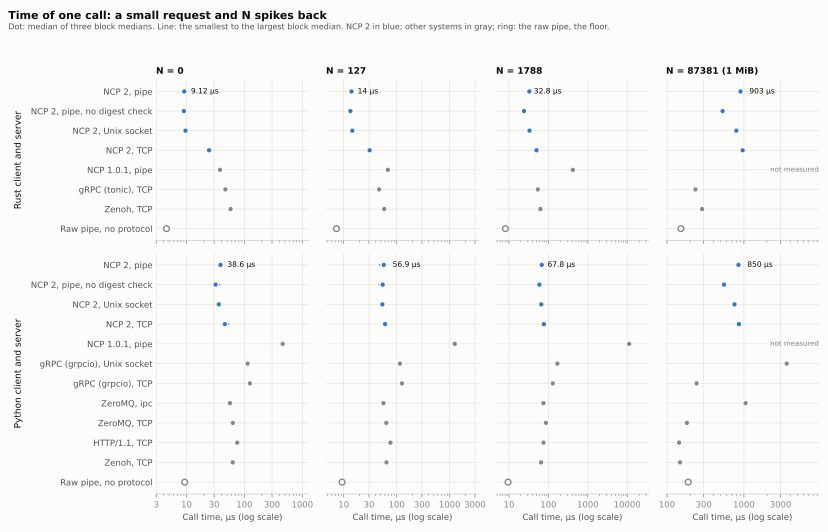
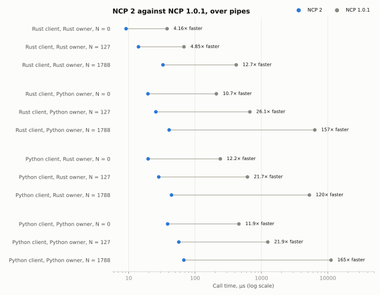
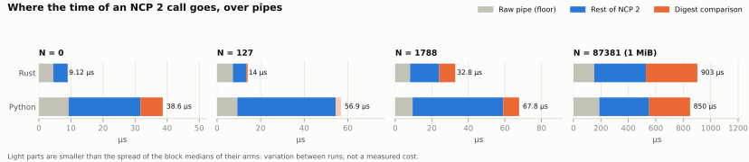
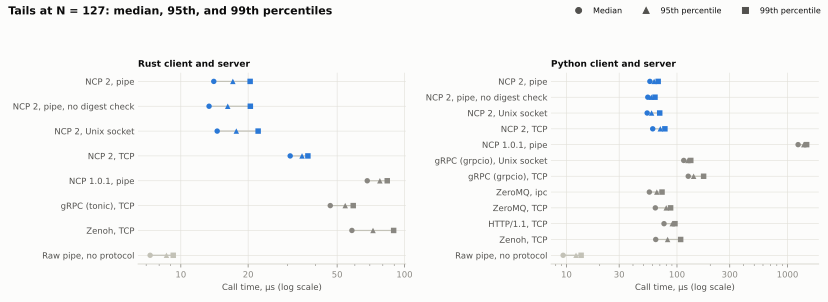

# Comparison benchmark

How long one call takes with NCP 2, with NCP 1.0.1, and with other ways for two programs on one computer to exchange a request and a response: gRPC, ZeroMQ, Zenoh, HTTP/1.1, and a raw pipe without a protocol.

The [protocol](PROTOCOL.md) was fixed before the timed runs (SHA-256 `e711a417…`, in [`PROTOCOL.sha256`](PROTOCOL.sha256)).
It fixes the workload, the 24 arms, the design, the validity checks, the hypotheses with their decision rules, and the analysis.
The validity checks passed: the Rust and Python tests, the shared conformance vectors, the model conformance of both owners, differential fuzzing of 200,000 frames, and a short run of every configuration.
The 276 timed runs ran on 23 October 2026 from 18:28 to 18:37 UTC, three blocks in a shuffled order, on an Apple MacBook Pro (Mac16,5, M4 Max) with macOS 26.5.1, Rust 1.99.1, and Python 3.15.0, on battery power in High Power Mode.
No run failed. Other programs were running: the one-minute load average before a run was 2.8 to 5.3.

Each call sends a small request and gets N spikes back, 12 bytes each.
Each value is the median of the three block medians; ranges are the smallest and largest block median.
All values are in [`results/summary.md`](results/summary.md).

<picture>
  <source media="(prefers-color-scheme: dark)" srcset="results/figures/calls_dark.svg">
  
</picture>

## Hypotheses

All five hypotheses hold in every block.

| # | Hypothesis | Result |
| --- | --- | --- |
| H1 | NCP 2 is faster than NCP 1.0.1. | 4.2 to 165 times faster, in all 12 comparisons of language pair and N. |
| H2 | NCP 2 meets its design targets. | Rust client and owner: 9.1 µs (target 15 µs). Python client and owner: 38.6 µs at N = 0 and 56.9 µs at N = 127 (target 150 µs). |
| H3 | NCP 2 adds little to the floor. | 4.6 µs more than the raw pipe at N = 0 (limit 10 µs). |
| H4 | In Rust, NCP 2 is faster than gRPC and Zenoh. | 10 of 10 comparisons. At N = 127: 14.0 µs over a pipe and 30.8 µs over TCP, against 46.6 µs for gRPC (tonic) and 58.2 µs for Zenoh. |
| H5 | In Python, NCP 2 is faster than gRPC and HTTP. | 9 of 9 comparisons. At N = 127: 56.9 µs, against 115.1 and 126.5 µs for gRPC (grpcio, Unix socket and TCP) and 76.3 µs for HTTP/1.1. |

<picture>
  <source media="(prefers-color-scheme: dark)" srcset="results/figures/versions_dark.svg">
  
</picture>

The two versions differ in three ways that affect this time: NCP 2 needs one round trip for each call instead of two, sends spikes as typed arrays instead of JSON lists, and hashes the exact frame bytes instead of a canonical form. The benchmark measures their sum, not each one alone. The ratio grows with N, as expected when NCP 1.0.1 encodes every spike as JSON numbers.

## Exploratory results

These questions had no hypothesis.

- **Python, against ZeroMQ and Zenoh.** NCP 2 is faster at N = 0 (38.6 µs; ZeroMQ over `ipc` 56.2 µs, Zenoh 62.8 µs) and about equal at N = 127 (56.9 µs, range 48.0 to 64.6; ZeroMQ 56.2 µs; Zenoh 64.2 µs) and at N = 1788 (67.8 µs; Zenoh 65.3 µs; ZeroMQ 74.9 µs). NCP 2 also checks every frame and gives exactly-once execution; the others do neither.
- **Tails.** At N = 127, NCP 2 has the lowest 99th percentile in each language: 20.4 µs in Rust over a pipe (gRPC 59.0 µs, Zenoh 89.5 µs) and 67.6 µs in Python (ZeroMQ 73.2 µs, HTTP/1.1 95.9 µs, Zenoh 108.0 µs, gRPC 174.2 µs).
- **Connections.** For small frames, a Unix domain socket costs about the same as a pipe; TCP adds about 15 µs in Rust at N = 0. At 1 MiB, the Unix domain socket is faster than the pipe (797 against 903 µs in Rust), because a pipe on macOS moves at most 64 KiB at a time.
- **1 MiB.** NCP 2 is slower than the arms without an integrity check: in Rust, 903 µs over a pipe against 234 µs for gRPC and 287 µs for Zenoh; in Python, 850 µs against 144 µs for HTTP/1.1 and 148 µs for Zenoh. Without the receiver's digest comparison, which specification section 3, rule 4 allows on pipes and Unix domain sockets with no program in between, NCP 2 takes 528 µs in Rust and 552 µs in Python.

<picture>
  <source media="(prefers-color-scheme: dark)" srcset="results/figures/decomposition_dark.svg">
  
</picture>

The digest comparison is the difference between the NCP 2 arm and the arm without it.
At 1 MiB it agrees with the measured speed of SHA-256 on this computer: 374 µs against 354 µs for one digest of 1 MiB with `sha2` 0.11.1 in Rust, and 298 µs against 302 µs with OpenSSL 4.0.3 in Python.
At N = 0 in Python, the difference of 6.9 µs is larger than the block ranges, but two SHA-256 digests of frames of this size take about 0.5 µs (230 ns each, measured). The rest of that difference has another cause, which this benchmark does not identify.
The rest of NCP 2 includes the sender's digest, the JSON encoding and decoding, the checks of the owner and client rules, and the copies of the arrays.

<picture>
  <source media="(prefers-color-scheme: dark)" srcset="results/figures/tails_dark.svg">
  
</picture>

## What the results do not show

Section 10 of the [protocol](PROTOCOL.md) lists the limits: one computer, lockstep calls by one client, call time without a real owner's work, other systems with their default settings, and different guarantees. NCP 2 sets 1 MiB socket buffers; the other arms keep their libraries' defaults, which affects their results most at 1 MiB.

## Correction to the protocol

Section 3 of the protocol says that the NCP 1.0.1 harness is the one of `benchmarks/pipelined-ack` at commit `99e9adc`.
That commit has no such directory. The harness comes from the pipelined-acknowledgement benchmark of the October 2026 campaign, on the branch `campaign/oct-2026`, which is not yet on `main`.
[`harness/ncp1/`](harness/ncp1) holds the exact files that the runs used. The NCP 1.0.1 SDK is the one of commit `99e9adc`, as the protocol says.
The protocol stays unchanged, so that its digest still identifies the text that was fixed before the runs.

## Reproduce

From this directory, with a checkout of the tag `sdk-v1.0.1` at `$NCP1`:

```sh
git worktree add "$NCP1" sdk-v1.0.1
python3.15 -m venv env
env/bin/pip install -r requirements.txt
env/bin/python run.py RESULTS --python env/bin/python --ncp1 "$NCP1"
env/bin/python analyze.py RESULTS
```

`run.py` builds the Rust programs with `cargo`, runs the validity checks, writes the schedule, and records every run in `RESULTS/runs.jsonl` as soon as it ends; it continues where it stopped if you start it again. `analyze.py` writes `analysis.json`, `summary.md`, and the figures.

## Files

| Path | Content |
| --- | --- |
| [`PROTOCOL.md`](PROTOCOL.md), [`PROTOCOL.sha256`](PROTOCOL.sha256) | The fixed protocol and its digest |
| [`run.py`](run.py), [`analyze.py`](analyze.py), [`requirements.txt`](requirements.txt) | The runner, the analysis, and the Python environment |
| [`harness/python/`](harness/python) | The Python clients and servers of the NCP 2, raw pipe, gRPC, ZeroMQ, HTTP/1.1, and Zenoh arms |
| [`harness/rust/`](harness/rust) | The Rust raw pipe, gRPC (tonic), and Zenoh arms |
| [`harness/ncp1/`](harness/ncp1) | The NCP 1.0.1 harness of `benchmarks/pipelined-ack`, with the spike body built once |
| [`results/`](results) | `schedule.json`, `validity.json`, `runs.jsonl`, `analysis.json`, `summary.md`, and `figures/` |
