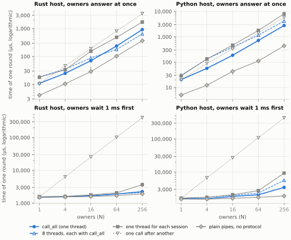
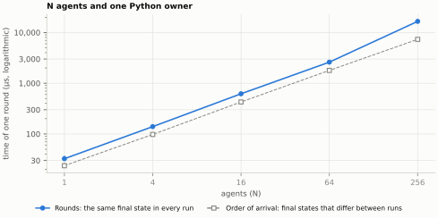
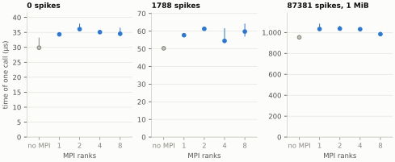

# Multi-agent benchmark

How NCP 2 behaves when one program works with many others:

- **Part F, one host and many owners.** A controller sends one request to each of up to 256 owner programs per step and waits for all responses.
- **Part R, many agents and one owner in rounds.** Up to 256 agents share one simulated world, which applies one request of each agent per round, in a fixed order ([rounds profile](../../spec/NCP-2-ROUNDS.md)).
- **Part M, an MPI program as the owner.** An owner made of 1 to 8 MPI processes serves one session from its first process, rank 0.

The [protocol](PROTOCOL.md) was fixed before the runs. It states the questions, the programs, the configurations, the hypotheses with their decision rules, and what the results do not show.

## In short

- **One program can call 256 others in one step in under a millisecond.** With `call_all`, which sends every request before it reads the first response, a Rust host finished a round over 256 owners in 0.92 ms and a Python host in 2.8 ms. That is 1.9 to 3.8 times faster than one thread for each session or one call after another. When every owner first waited 1 ms, the round over 256 owners took 2.3 ms in Rust instead of 406 ms one call after another, because the owners waited at the same time.
- **Many agents can share one world and agree on every step.** With the rounds profile, every agent received the same result after every round, and the world ended in the same state in every run, although their requests arrived out of member order in nearly every round. Applied in the order of arrival, the same requests left a different state in each run. With 64 agents, a round took 2.6 ms in Python: rounds cost 1.4 to 1.5 times as much as applying each request on arrival up to 64 agents, and 2.3 times with 256.
- **A parallel simulator can be coupled through its first process.** With 1 to 8 MPI processes, a call took 4 to 11 µs longer than without MPI, up to 1788 spikes, and every one of the 521 million spikes that the client checked, in 48 runs, arrived exactly.

<picture>
  <source media="(prefers-color-scheme: dark)" srcset="results/figures/fanout_dark.svg">
  
</picture>

<picture>
  <source media="(prefers-color-scheme: dark)" srcset="results/figures/rounds_dark.svg">
  
</picture>

<picture>
  <source media="(prefers-color-scheme: dark)" srcset="results/figures/mpi_dark.svg">
  
</picture>

## Results

The runs followed the [protocol](PROTOCOL.md) (SHA-256 `f80247fb…`) on 3 November 2026, from 09:27 to 09:55 UTC, on the power adapter, at NCP commit `648f7a9` with a clean worktree. Each point is the median of three block medians; [`results/summary.md`](results/summary.md) lists every configuration with the range of its block medians. All 13 hypotheses hold.

| # | Hypothesis | Holds | Measured |
| --- | --- | --- | --- |
| F1 | One host serves 64 owners that answer at once within one millisecond. | yes | Rust 237.6 µs, Python 716.9 µs |
| F2 | With `call_all`, owners that wait do their waiting at the same time. | yes | 64 owners that wait 1 ms: Rust 1.89 ms against 101.5 ms one call after another, Python 2.07 ms against 108.6 ms |
| F3 | Sending every request before reading the first response is faster than one thread for each session and than one call after another. | yes | 16 of 16 comparisons; at 256 owners, Rust 920.6 µs against 1712.9 and 3460.2, Python 2783.0 µs against 8041.3 and 5807.2 |
| F4 | What NCP 2 adds to each session falls as sessions are added. | yes | over plain pipes, per session: Rust 6.79 µs with one owner and 2.16 µs with 256; Python 15.50 and 9.15 µs |
| F5 | Threads that each use `call_all` on a share of the sessions help only where threads run in parallel. | yes | 256 owners: Rust 646.4 µs against 920.6 for `call_all`; Python 4190.9 µs against 2783.0 |
| R1 | In rounds, all agents agree on every round. | yes | every run passed: same state for every agent after every round, every record checked, no member excluded |
| R2 | In rounds, the world's state does not depend on the order in which requests arrive. | yes | one final state for each N across the three runs; 218 to 220 of 220 rounds arrived out of member order |
| R3 | Applied in the order of arrival, the same requests leave different states. | yes | different final states for every N of 4 or more |
| R4 | Rounds cost at most twice as much as applying requests on arrival up to 64 agents, and at most three times with 256. | yes | 1.37, 1.43, 1.45, 1.46, and 2.26 times for 1, 4, 16, 64, and 256 agents |
| R5 | A Python owner in rounds serves 64 agents at 200 rounds per second. | yes | 2605.9 µs per round, 384 rounds per second |
| M1 | The client receives exactly the spikes of all ranks. | yes | every run of part M finished without an error, so every spike matched |
| M2 | The rank-0 pattern adds little to a call of up to 1788 spikes. | yes | 4.5 to 6.2 µs with 0 spikes and 4.2 to 11.0 µs with 1788, for 1 to 8 ranks |
| M3 | The rank-0 pattern adds at most a fifth to a call of 1 MiB. | yes | 3.2 to 8.7 % |

### Part F: one host and N owners that answer at once

Median time of one round, in µs:

| Host | Mode | N = 1 | 4 | 16 | 64 | 256 |
| --- | --- | --- | --- | --- | --- | --- |
| Rust | `call_all` | 10.9 | 24.8 | 70.3 | 237.6 | 920.6 |
| Rust | 8 threads, each with `call_all` | 18.5 | 34.9 | 88.5 | 179.0 | 646.4 |
| Rust | one thread for each session | 18.0 | 33.2 | 154.1 | 486.5 | 1712.9 |
| Rust | one call after another | 10.6 | 45.8 | 191.4 | 809.0 | 3460.2 |
| Rust | plain pipes, no protocol | 4.1 | 10.5 | 28.7 | 102.8 | 367.2 |
| Python | `call_all` | 20.5 | 56.9 | 186.7 | 716.9 | 2783.0 |
| Python | 8 threads, each with `call_all` | 30.2 | 133.4 | 393.3 | 1154.0 | 4190.9 |
| Python | one thread for each session | 29.0 | 134.1 | 467.9 | 1776.4 | 8041.3 |
| Python | one call after another | 20.0 | 89.6 | 334.5 | 1406.0 | 5807.2 |
| Python | plain pipes, no protocol | 5.0 | 12.3 | 43.4 | 110.9 | 440.5 |

In Rust, eight threads that each use `call_all` on a share of the sessions were faster than `call_all` alone from 64 owners on; with fewer owners, waking the threads cost more than it saved. In Python, threads take turns, and `call_all` alone was the fastest way at every size. `call_all` stays single-threaded in both SDKs; a Rust host with many sessions can split them over threads itself.

### Part R: N agents and one owner

| Agents | Rounds (µs per round) | Order of arrival (µs per round) | Ratio |
| --- | --- | --- | --- |
| 1 | 32.5 | 23.7 | 1.37 |
| 4 | 139.7 | 97.9 | 1.43 |
| 16 | 620.0 | 427.2 | 1.45 |
| 64 | 2605.9 | 1789.2 | 1.46 |
| 256 | 16,575.8 | 7326.4 | 2.26 |

With 256 agents, the owner spends most of a round encoding responses one at a time, and every response carries the whole record of the round, 32 bytes and a name for each agent (protocol, section 12).

### Part M: the rank-0 owner of an MPI program

| Ranks | 0 spikes (µs per call) | 1788 spikes | 87381 spikes (1 MiB) |
| --- | --- | --- | --- |
| no MPI | 29.9 | 50.3 | 953.7 |
| 1 | 34.3 | 57.7 | 1033.2 |
| 2 | 36.1 | 61.3 | 1036.5 |
| 4 | 35.1 | 54.5 | 1031.5 |
| 8 | 34.5 | 59.8 | 984.3 |

### Deviations and notes

- The schedule was written at 09:17 UTC while the computer ran on battery, as `validity.json` records; the runner waited for the power adapter and started the first timed run at 09:27.
- Twelve attempts were disturbed: in each, the computer's two clocks drifted apart by 0.8 to 6.6 s, which the runner counts as sleep. The runner repeated them. Two runs of block 0, one call after another to 256 owners that wait 1 ms, one with each host, were still disturbed after three attempts and are left out (protocol, section 6). These two configurations rest on blocks 1 and 2; no hypothesis uses them.
- The 1 ms wait of the owners took about 1.5 ms (1514.8 µs for one plain pipe), against about 1.3 ms in the pilot runs.
- No run failed.

## What the results do not show

Section 11 of the protocol lists the limits. In short: one computer and one operating system; owners that only echo or sleep; the Python implementation of the rounds profile, the only one; all MPI ranks on one computer; and no other system.

## Files and how to repeat it

- [`results/`](results/): `schedule.json` (order, commit, protocol digest), `validity.json` (checks and environment), `runs.jsonl` (every attempt), `analysis.json` and `summary.md` (from `analyze.py`), and `figures/` (from `figures.py`).
- [`run.py`](run.py), [`analyze.py`](analyze.py), [`figures.py`](figures.py), and [`harness/`](harness/).

```sh
python3 benchmarks/multi-agent/run.py RESULTS_DIR --python python3.15 --mpi-env CONDA_ENV
python3 benchmarks/multi-agent/analyze.py RESULTS_DIR
python3 benchmarks/multi-agent/figures.py RESULTS_DIR   # needs matplotlib
```

The runner needs cargo, a Python 3.11 or later for parts F and R, and a conda environment with Open MPI, mpi4py, and numpy for part M (`CONDA_ENV/bin/python` and `CONDA_ENV/bin/mpirun`).
It builds the harness and the clock probe of the NEST campaign, runs the validity checks of the protocol, writes the schedule, and then runs three blocks of 125 configurations, waiting before each run for the conditions of [`../conditions.py`](../conditions.py) (macOS).
It appends each run to `RESULTS_DIR/runs.jsonl`; when it stops, the same command resumes it.
Put `RESULTS_DIR` outside the repository: the runner builds its programs in `RESULTS_DIR/.work`.
