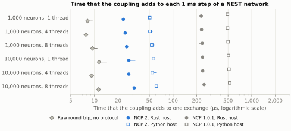
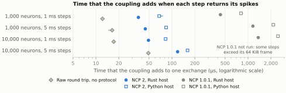

# NEST campaign

What it costs to couple NEST 3.10.0 to a peer process with NCP 1.0.x, NCP 2, and MUSIC 1.2.1, for three networks, four network sizes, one to eight NEST threads, exchange intervals of 1, 5, and 20 ms, and two payloads; and whether each coupling delivers the exact spikes.
All runs used the NEST 3.10.0 build described in [`../nest-coupling`](../nest-coupling), with Open MPI 5.0.10 and MUSIC 1.2.1, on an Apple MacBook Pro (Mac16,5, M4 Max) with macOS 26.5.1, from 22 to 24 October and on 2 November 2026.

Seven protocols were fixed before their runs:

| Protocol | Question | Runs | Status |
| --- | --- | --- | --- |
| [`PROTOCOL.md`](PROTOCOL.md) (run 1) | Cost of the coupling with NCP 1.0.x and MUSIC | 573, of which 9 failed closed | Superseded: the readback dominated the cost (see below) |
| [`PROTOCOL-2.md`](PROTOCOL-2.md) | The same, with a readback of constant cost | 558 | The timing results for NCP 1.0.x and MUSIC |
| [`PROTOCOL-CONTENT.md`](PROTOCOL-CONTENT.md) | Exact delivery of every spike | 72 trials | The content results |
| [`PROTOCOL-3.md`](PROTOCOL-3.md) | Cost of the coupling with NCP 2, against NCP 1.0.1 and MUSIC | 774 in run 1 | Content valid; timing disturbed (see below) |
| [`PROTOCOL-4.md`](PROTOCOL-4.md) | Protocol 3 under controlled conditions, with the time of every step | 43 attempts, then stopped | A pilot: its clock check at the end of a run marked normal readings as disturbed (see below) |
| [`PROTOCOL-5.md`](PROTOCOL-5.md) | Protocol 4 with a clock limit of 3.8 GHz at the end of a run | 774 | The timing results for NCP 2 against NCP 1.0.1 |
| [`PROTOCOL-CONTENT-2.md`](PROTOCOL-CONTENT-2.md) | Exact delivery of every spike with NCP 2, also with 10,000 neurons | not yet run | Fixed on 2 November 2026 |

[`summary.md`](summary.md) holds the tables of protocols 1, 2, and the content part; `summary.py` writes it from the analysis files. [`results-3/summary.md`](results-3/summary.md) holds those of protocol 3, and [`results-5/summary.md`](results-5/summary.md) those of protocol 5.

## In short

In protocol 5, an NCP 2 exchange added 23 to 32 µs to each 1 ms step of the Brunel network with a Rust host, and 50 to 61 µs with a Python host.
NCP 1.0.1 added 228 to 248 µs and 492 to 524 µs, 8 to 10 times as much.
A round trip to an echo process without a protocol took 8 to 11 µs.
When each step returned its spikes, NCP 2 added 36 to 119 µs with a Rust host. NCP 1.0.1 added 434 to 1,365 µs, and it cannot carry the largest steps.
NCP 1.0.1 delivered exactly the spikes that NEST recorded, with every thread count; MUSIC did so only with one NEST thread.
For NCP 2, protocols 3 and 5 check the number of spikes in every run; content protocol 2 compares every spike.

These times are measured inside the processes. They leave out one effect: a coupled NEST can do its own work more slowly than NEST alone.
At 10,000 neurons, that effect varied between runs by more than the time of an exchange, so the campaign does not give the whole cost of a coupling there (protocol 5, G1 and G3).

<picture>
  <source media="(prefers-color-scheme: dark)" srcset="results-5/figures/overhead_dark.svg">
  
</picture>

<picture>
  <source media="(prefers-color-scheme: dark)" srcset="results-5/figures/spikes_dark.svg">
  
</picture>

## Measures

`chunked` runs NEST in intervals of Δ in one process and reads the spike count after each; an NCP arm does the same through a host that calls the NEST owner once per interval.
The NCP cost per exchange is O = (W(NCP arm) − W(`chunked`)) / (2000/Δ), where W is the wall time of a run with 2 s of simulated time, paired within a block.
The MUSIC cost per run is W(`music`) − W(`mono`), where `mono` runs the 2 s in one call.
Both are differences of wall times of separate processes, so their noise grows when the network's own run time is long and the number of exchanges is small (for example 10,000 neurons at Δ = 20 ms: 100 exchanges); some medians are then negative.
Protocol 4 therefore also times every step inside the processes. Its overhead of a step is the host's call minus the owner's NEST work of the same step, or the raw round trip of a `chunked-pipe` arm, which sends the result to an echo process after each interval without a protocol.

## Results of protocol 2

All 558 runs were valid, and every arm recorded the same number of spikes in NEST's own recorder within each configuration and block. The recorder totals equal those of run 1 in all 558 runs (H6).

| # | Hypothesis | Holds |
| --- | --- | --- |
| H1 | At Δ = 1 ms, the Python SDK 1.0.1 costs less per exchange than 1.0.0, for each size and thread count. | yes |
| H2 | The median of the 18 median costs per exchange of the Python SDK 1.0.1 in part D1 is at most 0.6 ms. | yes: 0.52 ms |
| H3 | A Rust host costs less per exchange than a Python host in every configuration of D1. | no |
| H4 | With 25,000 neurons, the Python SDK's cost per exchange is at most twice that with 250 neurons. | yes: 0.57 and 0.50 ms |
| H5 | Every run is valid, and the recorded counts agree across arms. | yes |
| H6 | The recorder totals equal those of run 1. | yes |

- **Cost per exchange.** At Δ = 1 ms in D1, an exchange cost 0.48 to 0.56 ms with the Python SDK 1.0.1, 1.39 to 1.59 ms with 1.0.0, and 0.19 to 0.25 ms with a Rust host and the Python owner. H3 fails in two of the 18 configurations, both with 10,000 neurons at Δ = 20 ms (100 exchanges per run), where the noise described above dominates; in the other 16, the Rust host costs less.
- **Spikes in every step (D4).** Returning the spikes, as JSON numbers, cost 0.8 to 2.6 ms per exchange with the Python SDK. Brunel with 10,000 neurons at Δ = 5 ms is not in protocol 2: some steps had up to 8,112 spikes, more than the 65,536-byte frame of NCP 1.0.x can carry.
- **MUSIC.** MUSIC added 2.0 to 28.7 ms to a 2 s run of the 1000-neuron Brunel and alpha networks, much less than NCP 1.0.x, which makes a round trip between processes for each exchange. With the adaptive (`aeif`) network, it added about 1.1 s with one thread and 0.07 s with four. MUSIC runs inside one MPI job. The timing of MUSIC runs with more than one thread measures a coupling that does not deliver the correct spikes (next section). Part D4 has no `mono` arm, so it gives no MUSIC cost.

## Results of the content protocol

| NEST threads | Trials | NCP 1.0.1 exact | MUSIC exact | MUSIC channels with the exact spike train (of 1000) |
| ---: | ---: | ---: | ---: | ---: |
| 1 | 18 | 18 | 18 | 1000 |
| 2 | 18 | 18 | 0 | 500 |
| 4 | 18 | 18 | 0 | 250 |
| 8 | 18 | 18 | 0 | 125 |

NCP 1.0.1 delivered exactly the spikes of the reference in every trial, with every thread count.
MUSIC delivered exactly the recorded spikes with one NEST thread; with T threads, only n/T of the n channels carried the exact train of their neuron, while NEST's own recorder was correct.
[`music-threads/`](music-threads) reproduces this with the per-neuron and the channel-list forms of the MUSIC connection.

## Protocol 3, run 1

All 774 runs of 23 October 2026 (19:00 to 20:48 UTC) were valid. At every NCP host, the number of received spikes equalled NEST's recorder total, the recorded counts agreed across arms within each configuration and block (G4), and they equal protocol 2's totals (G5). NCP 2 delivered steps of Brunel with 10,000 neurons at Δ = 5 ms, which NCP 1.0.x refuses. Protocol 3 compares numbers of spikes, not the spikes themselves; [content protocol 2](PROTOCOL-CONTENT-2.md) compares every spike.

The timing of the run is disturbed:

- The computer ran on battery for the first 30 minutes.
- During block 1, its lid was closed for 7.5 minutes. The computer then slept for 5 to 8 s in each minute, and its thermal pressure rose to level 4 several times.
- The one-minute load average before a run had a median of 6.6. Its six highest values, 38 to 125, fell between 19:34 and 19:36 UTC, while the computer slept and woke; their cause is not established.
- The reference became slower and stayed slower. `mono` of Brunel with 1000 neurons and 1 thread took 0.675 s in block 0 and in protocol 2, 0.934 s in block 2, and 0.877 s on 24 October. On 24 October the processor ran at about 3.1 GHz on one core and 2.9 GHz on all cores (an M4 Max performance core is rated at up to 4.5 GHz), with High Power selected and the power adapter connected.

The `chunked` reference took as long as in protocol 2 in block 0 (median ratio 1.00), and 26 % and 37 % longer in the medians of blocks 1 and 2, with single runs up to 14 times longer. Single block values of the cost per exchange therefore lie between −172 and +272 ms.

| # | Hypothesis | Holds |
| --- | --- | --- |
| G1 | At Δ = 1 ms in D1, NCP 2 costs less per exchange than NCP 1.0.1, for each host language, size, and thread count, in every block. | no; the timing is disturbed |
| G2 | The median of the six median costs per exchange of NCP 2 with the Rust host at Δ = 1 ms in D1 is at most 0.10 ms. | yes: 0.036 ms |
| G3 | Each D4 configuration of NCP 2 with the Rust host has a median cost per exchange of at most 0.15 ms. | no; the timing is disturbed |
| G4 | Every run is valid, and the recorded counts agree across arms. | yes |
| G5 | The recorder totals equal those of protocol 2. | yes |

The records stay in [`results-3/`](results-3) as they were written.

## Protocol 4

Protocol 4 repeats protocol 3 and adds the time of every step. Before each run, `run4.py` waits for the power adapter, nominal thermal pressure, a core at 4.0 GHz or more, and a load average below 8. It repeats a run during which the computer slept or the conditions failed. A block whose `chunked` reference drifts more than 10 % from protocol 2 leaves the timing hypotheses unadjudicated.
It could not run before 2 November 2026, because the processor stayed limited to about 3.1 GHz from 23 October until a restart.
Its smoke runs, under that limit, gave median overheads per exchange of 29 and 35 µs for NCP 2 with the Rust host, against 13 and 14 µs for the raw round trip and 299 and 313 µs for NCP 1.0.1; [`profiling/`](profiling) explains why the owner's protocol code is slower inside the NEST process than without NEST. These numbers are not results.

Corrections to the background text of [`PROTOCOL-4.md`](PROTOCOL-4.md), found on 24 October 2026 before any run; the rules of the protocol are not affected:

- It says that other programs raised the load average up to 125. The highest values fell while the computer slept and woke with its lid closed; their cause is not established.
- It says that the processor ran at up to 4.5 GHz before. That is the rating of the chip; no clock was measured before 24 October. The measured evidence is the slower `mono` reference.
- It says that the owner's protocol code runs two to four times slower inside the NEST process. Against the owner without NEST, the profile gives 1.6 times with a count and 2.3 to 3.2 times with spikes.

The gate's clock threshold of 4.0 GHz had not been observed at full speed when protocol 4 was fixed. After the restart of 2 November 2026, the probe read 4.009 to 4.491 GHz before the attempts of protocol 4, so no deviation was needed.

## Protocol 5

Protocol 4 started on 2 November 2026 at 00:13 UTC and was stopped at 00:19 UTC after 43 attempts of block 0.
11 attempts were marked as disturbed only because a core ran at 3.962 to 3.999 GHz just after a long run, below the limit of 4.0 GHz that protocol 4 set to detect the limit of about 3.1 GHz. Seven of them were attempts of the NCP 1.0.1 Rust host, so the check would have removed the slower arms' long runs more often than the others.
[Protocol 5](PROTOCOL-5.md) is protocol 4 with one change: a run is disturbed when a core runs below 3.8 GHz at its end. The conditions before a run do not change. The 43 attempts are kept in [`results-4-pilot/`](results-4-pilot) as a pilot record; they are not results.

## Results of protocol 5

All 774 runs ran on 2 November 2026 from 00:22 to 02:20 UTC, each at its first attempt, from the clean commit `ac8fbf9`.
Before each run, the computer drew power from its adapter at thermal pressure 0, a core ran at 4.000 to 4.508 GHz, and the one-minute load average was 1.69 to 7.96.
No run slept. The runner waited 44 minutes in all for these conditions.
At the end of a run, a core ran at 3.873 to 4.508 GHz. 164 runs, of every arm, ended below 4.0 GHz; protocol 4 would have repeated them.
In the medians of the three blocks, the `chunked` reference took 1.003 to 1.007 times as long as in protocol 2, so every block is admissible for timing.

| # | Hypothesis | Holds |
| --- | --- | --- |
| G1 | At Δ = 1 ms in D1, NCP 2 costs less per exchange than NCP 1.0.1, for each host language, size, and thread count, in every block. | no: 11 of 12 comparisons hold (see below) |
| G2 | The median of the six median costs per exchange of NCP 2 with the Rust host at Δ = 1 ms in D1 is at most 0.10 ms. | yes: 0.032 ms |
| G3 | Each D4 configuration of NCP 2 with the Rust host has a median cost per exchange of at most 0.15 ms. | no: 0.200 ms with 10,000 neurons at Δ = 5 ms (see below); 0.044 to 0.054 ms in the other three |
| G4 | Every run is valid, and the recorded counts agree across arms. | yes |
| G5 | The recorder totals equal those of protocols 2 and 3. | yes: 759 runs compared with protocol 2, and 774 with protocol 3 |
| G6 | At Δ = 1 ms in D1, the median overhead of NCP 2 is lower than that of NCP 1.0.1, for each host language, size, and thread count, in every block. | yes: 12 of 12 comparisons |
| G7 | Each D4 configuration of NCP 2 with the Rust host has a median overhead of at most 0.15 ms. | yes: 36 to 119 µs |

- **Overhead per exchange.** At Δ = 1 ms in D1, NCP 2 added 23 to 32 µs to an exchange with the Rust host and 50 to 61 µs with the Python host: 7.7 to 9.8 and 8.5 to 9.7 times less than NCP 1.0.1, which added 228 to 248 µs and 492 to 524 µs. The raw round trip took 8 to 11 µs; NCP 2 with the Rust host added 15 to 21 µs more than that. With longer steps, the overhead of every arm grew, the raw round trip included: at 10,000 neurons and Δ = 20 ms, it was 24 to 31 µs for the raw round trip and 79 to 98 µs for NCP 2 with the Rust host. The campaign does not identify the cause.
- **Spikes in every step (D4).** NCP 2 sends the spikes of a step as two binary arrays. It added 36 to 119 µs with the Rust host and 68 to 160 µs with the Python host. NCP 1.0.1 sends them as lists of JSON numbers. It added 434 to 1,365 µs and 810 to 2,481 µs, and it cannot carry the steps of 10,000 neurons at Δ = 5 ms, so those runs are not in the protocol.
- **G1.** The comparison that fails is Brunel with 10,000 neurons on 1 thread with the Rust host, in block 0. From the wall times, NCP 2 cost 0.260 ms per exchange and NCP 1.0.1 cost 0.229 ms. Inside the same two runs, the overhead was 33 µs for NCP 2 and 237 µs for NCP 1.0.1. The difference comes from NEST's own work: a step took 5.14 ms in that NCP 2 run, 4.92 ms in the `chunked` run, and 4.90 ms in the NCP 1.0.1 run. In this configuration, the work of a step in a coupled run differed from that in the `chunked` run of the same block by −0.04 to +0.38 ms, the raw round trip included.
- **G3.** The cost of NCP 2 with the Rust host at 10,000 neurons and Δ = 5 ms was 0.152, 0.200, and 0.549 ms in the three blocks, above the target of 0.15 ms in each. Its overhead was 116 to 120 µs (G7). The rest is the change of NEST's own work in the coupled run. For this arm, that change was 0.05 to 0.47 ms in the three blocks; for the raw round trip, −0.13 to +0.33 ms. With 400 exchanges in a run, the difference of wall times cannot separate the two, as protocol 4 expected.

Whether a coupling slows NEST's own work is open. Protocol 4 defines this effect only as an exploratory measure, and its sign changes between configurations and blocks.
The tables are in [`results-5/summary.md`](results-5/summary.md). `figures.py` draws the figures from `results-5/analysis.json`.

## Why run 1 is superseded

In PyNEST 3.10, each read of a spike recorder's `n_events` or `events` copies all events recorded so far.
Run 1 read the recorder after every interval, so the read grew with the run and dominated both the `chunked` reference and the NCP arms: with 10,000 neurons, 4 threads, and Δ = 1 ms, `nest.Run` took 1.36 ms per interval and the read added 8.6 ms.
Protocol 2 reads the count from the kernel's `local_spike_counter` and the new spikes from the recorder's ASCII files, at a constant cost per interval, and checks both against the recorder total.
Run 1's results stay in [`results/`](results) as a record; its differences are unbiased but too noisy for the NCP cost of large networks. Its 9 failed runs are the NCP runs of Brunel with 10,000 neurons at Δ = 5 ms in D4, which NCP 1.0.x refused because a step's result exceeded its frame.

## Files

| Path | Content |
| --- | --- |
| `PROTOCOL*.md`, `PROTOCOL*.sha256` | The fixed protocols and their digests |
| `run.py`, `content_run.py`, `run3.py`, `run4.py` | The runners; each resumes after an interruption; `run4.py --protocol 5` runs protocol 5, and `content_run.py --protocol 2` the content protocol 2 |
| `analyze.py`, `analyze_content.py`, `analyze_content2.py`, `summary.py`, `analyze3.py`, `analyze4.py`, `figures.py` | The analyses, the tables, and the figures of protocol 5 |
| `harness/` | The networks, the NEST owners, the Python and Rust hosts of NCP 1.0.1 and NCP 2, the raw round trip, the MUSIC peer, the content checks (`content.py`, `content2.py`), and the clock probe |
| `results/`, `results-2/`, `results-content/`, `results-3/`, `results-5/` | Schedules, environments, every run, and the analyses; `results-5/figures/` holds the figures |
| `results-4-pilot/` | The 43 attempts of protocol 4 that led to protocol 5; a pilot record, not results |
| `music-threads/` | The reproduction of the MUSIC result with more than one thread |
| `profiling/` | Where the time of an NCP 2 exchange goes inside the NEST process |
