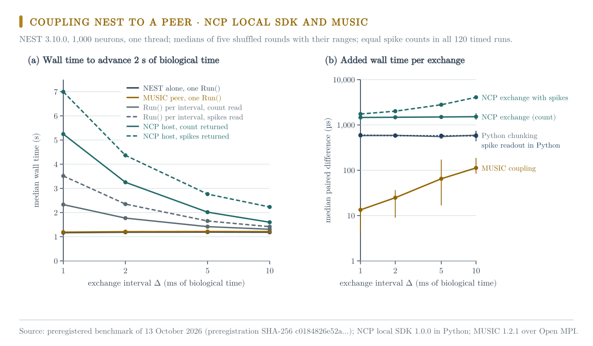

# Coupling NEST to a peer process: NCP local SDK and MUSIC

This directory holds a preregistered benchmark of 13 October 2026.
It measures the wall-time cost of coupling a NEST 3.10.0 network to a separate peer process.
One route uses the NCP local SDK 1.0.0 in Python.
The other route uses MUSIC 1.2.1 over Open MPI 5.0.10.

The result describes these implementations under this workload on one computer.
It does not rank the two protocol designs.
It gives no real-time bound and no worst-case bound.

## Computer, software, and times

All runs used one computer:

| Component | Specification |
|---|---|
| Computer | Apple MacBook Pro, model identifier Mac16,5, system firmware 18000.120.36 |
| Chip | Apple M4 Max: 16 CPU cores (12 performance in two clusters, 4 efficiency), 40-core GPU (Metal 4) |
| Caches | L2 16 MB for each performance cluster, L2 4 MB for the efficiency cluster, 128-byte cache lines |
| Memory | 128 GB unified memory, 16 KB pages |
| Storage | 4.0 TB internal SSD, APFS |
| Operating system | macOS 26.5.1 (25F80), Darwin 25.5.0 (xnu-12377.121.6), System Integrity Protection on |
| Power during the runs | Mains power, battery at 99 to 100 percent, automatic power mode, idle system sleep prevented |
| Other load | Normal use with other processes. The 1-minute load average was 2.9 to 4.6 before the timed regions. |
| Toolchain | Xcode 26.6 (17F113), Apple clang 21.0.0 (clang-2100.1.1.101), macOS SDK 26.5, CMake 3.29.6 |
| NEST | 3.10.0, built from the release archive with MPI, MUSIC, and OpenMP by [`environment/build-nest-music.sh`](environment/build-nest-music.sh) |
| MPI and MUSIC | Open MPI 5.0.10 (conda-forge), MUSIC 1.2.1 built from source |
| Python | 3.11.15 with NumPy 1.26.4 in the NEST environment. The driver `run_bench.py` ran under Python 3.14.6. |
| NCP | Commit `6feba8d`. Its Python `ncp_local` source equals the `sdk-v1.0.0` release. |

These files give the complete record:

- [`environment/environment.json`](environment/environment.json) records the hardware, operating system, toolchain, and NEST build.
- [`environment/nest-3.10.0.conda-explicit.txt`](environment/nest-3.10.0.conda-explicit.txt) lists all 160 conda packages with build strings and MD5 digests.
- [`environment/runs.json`](environment/runs.json) gives the time of each step in UTC and the power evidence.
- [`environment/capture_environment.py`](environment/capture_environment.py) writes `environment.json` and the package lists again.

The NEST release archive has SHA-256 `8fbd7df4a3e941784d4b1d5825ded234bdc915238faac0982c62e4cb80134d52`.
The MUSIC archive has SHA-256 `7bf8160ba4f261b8fa14bf8ceab318912b8b8d8a1d8e653c6fbdd45eb27a51c7`.
The build finished at 2026-10-12T21:59:27Z.
The NEST test suite ran 5503 tests and skipped 17.
It reported one failure and seven errors, all in the phases that start MPI processes directly.
Each of those 30 test files passed when it ran alone.
The seven MUSIC tests passed.
See [`environment/nest-3.10.0-testsuite-summary.txt`](environment/nest-3.10.0-testsuite-summary.txt) and [`environment/nest-3.10.0-mpi-direct-per-file.txt`](environment/nest-3.10.0-mpi-direct-per-file.txt).

| Step | UTC, 13 October 2026 |
|---|---|
| Preregistration hashed | 16:38:34 |
| Warm-up and five timed rounds | 16:38:34 to 16:47:43 |

## Preregistration

[`PREREGISTRATION.md`](PREREGISTRATION.md) fixed the question, arms, workload, design, validity checks, and analysis before the timed runs.
Its SHA-256 is in [`PREREGISTRATION.sha256`](PREREGISTRATION.sha256).
The harness recorded the same digest in `results/results.json` when the timed runs started.
Do not edit the preregistration.
Smoke runs before it only checked the code and calibrated the input.
Their outputs are `results/smoke.json` and `results/smoke2.json`. They are not results.

## Arms and comparisons

Each arm advances T = 2 s of biological time with an exchange every Δ, for Δ in {1, 2, 5, 10} ms:

- `mono`: one `nest.Run(T)` without any exchange.
- `chunked`: `nest.Run(Δ)` T/Δ times. The spike count is read after each call.
- `chunked-spikes`: the same, but the senders and times of the new spikes are read.
- `ncp`: a host drives NEST in a child process with `ncp_local`. Each `step` result carries the spike count.
- `ncp-spikes`: the same, but each result carries the senders and times.
- `music`: `mpirun` starts NEST and a peer. NEST runs one `nest.Run(T)` and sends every spike to the peer. The peer returns one event per tick.

The preregistered comparisons are paired differences within a round:

- NCP protocol cost: W(`ncp`) minus W(`chunked`).
- NCP cost with spike content: W(`ncp-spikes`) minus W(`chunked-spikes`).
- MUSIC cost: W(`music`) minus W(`mono`).
- Python chunking cost: W(`chunked`) minus W(`mono`).
- Python spike readout cost: W(`chunked-spikes`) minus W(`chunked`).

The NCP baseline is `chunked` because a lockstep host must get control back after each interval.
MUSIC exchanges events inside the NEST update loop, so its baseline is `mono`.

## Results

All 120 timed runs were valid.
In each run the peer or host received exactly the spikes that NEST recorded.
Each arm gave the same count as `chunked` for the same Δ: 25448, 25448, 25419, and 25356 spikes.

| Δ (ms) | `mono` | `music` | `chunked` | `chunked-spikes` | `ncp` | `ncp-spikes` |
|---|---|---|---|---|---|---|
| 1 | 1.166 | 1.189 | 2.329 | 3.514 | 5.246 | 6.996 |
| 2 | 1.186 | 1.208 | 1.769 | 2.351 | 3.252 | 4.366 |
| 5 | 1.191 | 1.215 | 1.416 | 1.651 | 2.015 | 2.763 |
| 10 | 1.185 | 1.212 | 1.308 | 1.415 | 1.598 | 2.230 |

The table gives the median wall time in seconds over five rounds.
[`results/analysis.json`](results/analysis.json) also gives the minimum, the maximum, and all paired differences.

| Δ (ms) | NCP exchange | NCP exchange with spikes | Python chunking | Python spike readout | MUSIC |
|---|---|---|---|---|---|
| 1 | 1463 µs | 1743 µs | 582 µs | 598 µs | 13.4 µs |
| 2 | 1477 µs | 2014 µs | 589 µs | 579 µs | 24.8 µs |
| 5 | 1499 µs | 2793 µs | 554 µs | 580 µs | 64.9 µs |
| 10 | 1520 µs | 4076 µs | 594 µs | 572 µs | 112.8 µs |

This table gives the median paired difference for each exchange.
MUSIC added 23 to 27 ms for each run at every Δ.
This is about 2 percent of the time for NEST alone.
Spread over about 25000 transmitted spikes, the MUSIC cost is about 1 µs for each spike.
The NCP exchange added about 1.5 ms for each exchange at every Δ.
Spike content added about 20 µs for each transmitted spike.

## Interpretation

On this workload and computer, the MUSIC route costs about two orders of magnitude less for each exchange.
Most of the NCP cost is fixed for each exchange:

- one round trip over process pipes,
- framing and integrity checks,
- the acknowledgement of a lockstep request, all in Python.

MUSIC sends events between co-launched simulators on a shared clock.
It does not acknowledge each message.
The NCP local profile gives separately owned programs exact request identities, retained outcomes, and digest-bound acknowledgements.
A lockstep controller that must see each result before it acts pays one round trip for each interval.

## Constraints found before the runs

- NEST 3.10 does not let recorder parameters change between `Prepare` and `Cleanup`. A recorder cannot be cleared between intervals. The spike arms therefore copy the event arrays and keep the unseen part.
- The NEST 3.10 Python interface does not implement `SetAcceptableLatency`. The NEST MUSIC input port accepts no latency. The peer input port accepts two ticks, so the MUSIC acknowledgement can arrive up to two ticks late.
- A small calibration grid set the input. Neighboring settings gave 4.8 to 45 Hz.

## Limits

- One computer, in normal use with other processes.
- The Python NCP SDK only. The Rust SDK was not measured.
- MUSIC over shared-memory MPI on one host only.
- One network, one thread, and one peer.
- Five rounds give no confidence level.

## Reproduce

1. Build NEST with [`environment/build-nest-music.sh`](environment/build-nest-music.sh) into a conda environment made from [`environment/nest-3.10.0.conda-explicit.txt`](environment/nest-3.10.0.conda-explicit.txt).
2. Run `python3 run_bench.py ENV_PREFIX NCP_CHECKOUT/local/python OUT.json`.
3. Run `python3 analyze.py OUT.json` to compute the preregistered analysis.

The published `results/*.json` files differ from the files as written in one field only.
The local checkout path in `environment.ncp_local_dir` is replaced by `<NCP checkout>/local/python`.
[`results/REDACTION.json`](results/REDACTION.json) gives the SHA-256 of each file before and after this change.
