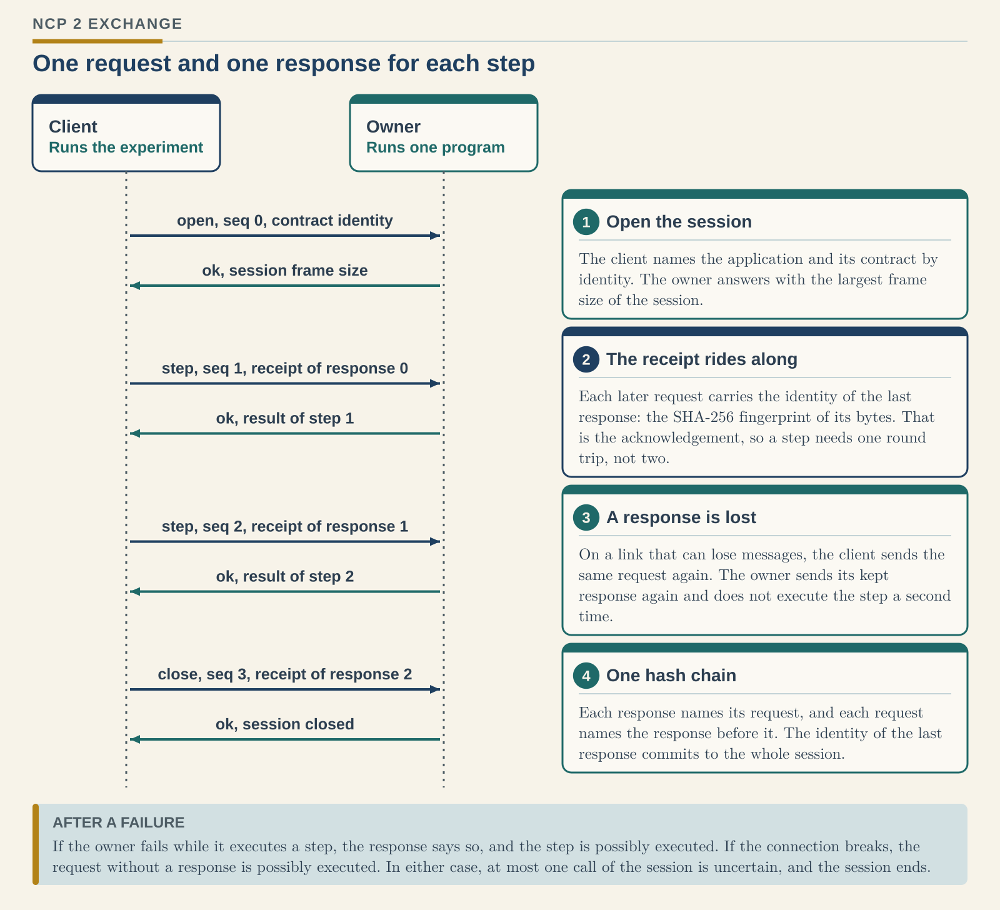
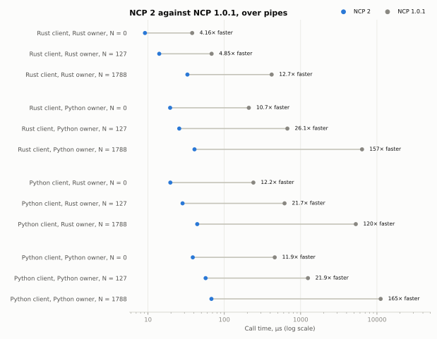
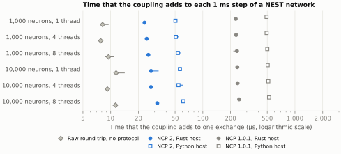
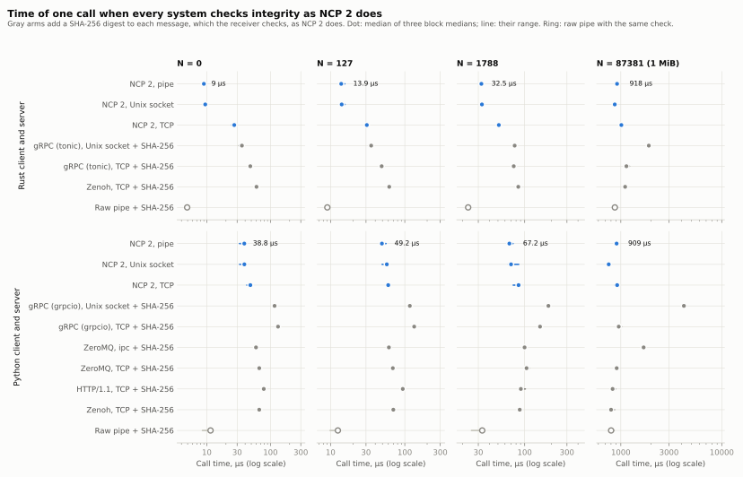

# NCP 2 in plain words

This guide explains NCP 2 for readers without a background in protocols.
The [specification](../spec/NCP-2.md) is the exact definition; where this guide and the specification differ, the specification is correct.
NCP 2 is in development and not yet released.

## What NCP is for

Research on closed loops connects programs that different people write: a simulated brain (for example NEST), a simulated body or world, monitors, and recorders.
Each program runs in its own process, and they work in steps.
One program, the **client**, asks another program, the **owner**, to do one step, and waits for the result.

NCP is the agreement about how these requests and results travel between the programs.
It makes sure that:

- no step runs twice, even when a message is repeated;
- a program always learns whether its step ran, did not run, or possibly ran;
- damaged messages are detected;
- a record of the messages can show afterwards exactly what was sent, and in which order.

NCP does not know what a step means. Each application describes its own steps and data in its **contract**.

## One step at a time

<picture>
  <source media="(prefers-color-scheme: dark)" srcset="diagrams/ncp2-call-dark.svg">
  
</picture>

A **session** is one conversation between one client and one owner.
It starts with `open`, in which the client names the application and its contract, and it ends with `close` or with a failure.

Every message has an **identity**: a SHA-256 fingerprint of its exact bytes, 64 characters long.
Two different messages have different fingerprints in practice, and any change to a message changes its fingerprint.

Each request after `open` carries the identity of the last response that the client received.
This is the client's **receipt**. With it, the owner knows that the client has the previous result, and it can let go of that result.
NCP 1 sent the receipt as a separate message, so each step needed two round trips. NCP 2 needs one.

Because each request names the response before it, and each response names its request, the messages of a session form one chain.
The identity of the last response commits to every message of the session, as the last link of a chain holds all links before it.

## What a response tells the client

| Outcome | Meaning | What happens next |
| --- | --- | --- |
| `ok` | The owner ran the request once. The body is the result. | The session continues. |
| `rejected` | The owner ran nothing for this message, and nothing changed. A code says why, for example a wrong sequence number or an unknown operation. | The client can send a corrected request. |
| `ended` | The session cannot continue. The code says whether the request ran. | The client opens a new session if it needs one. |

"Possibly executed" means that the client cannot know whether the step ran: the owner failed during the step, or the connection broke before the response arrived.
In a session, at most one call can be in this state, and it is always the last one.

## When something goes wrong

| What happens | What NCP 2 does | What the client learns |
| --- | --- | --- |
| A message is damaged on the way | The receiver computes the fingerprint again and finds a difference. | No damaged request runs. On a pipe or a socket, the session ends. |
| A message is lost, on a link that can lose messages | The client sends the same request again. The owner recognizes it and sends its kept response again. | The result, from one run of the step. |
| A message arrives twice | The owner recognizes the copy and sends its kept response again. | The same result; the step ran once. |
| An old copy arrives late | The owner rejects it, because a later request has already run. | Nothing runs again. |
| The owner fails during a step | It answers `ended` with the code `owner_failure`. | The step possibly ran. |
| The connection breaks | The session ends. | The request without a response possibly ran. |
| A result is larger than the session allows | The owner answers `ended` with the code `result_too_large`, the size, and the limit. | The step ran; only its result was too large to send. |

These rules are proved for the owner (see [How we know that it works](#how-we-know-that-it-works)).

## Large data

A message can carry arrays of numbers, such as the neurons and times of spikes, as binary **attachments** next to its text part.
A program can read an attachment in place, without converting it.
The client chooses the largest message size of a session when it opens it: from 64 KiB to 64 MiB, and 1 MiB by default.
NCP 1 had a fixed limit of 64 KiB, and a result above it stopped the run.

## Streams

For live data, such as sensor readings, NCP 2 also has **streams**: a publisher sends numbered messages to any number of subscribers.
Each stream message names the one before it, so a subscriber can see when messages are lost, arrive in the wrong order, or were changed.
Streams do not resend lost messages: for live data, the next reading is usually more useful than an old one.

## How fast it is

One call with a small result took 9.1 µs between two Rust programs and 38.6 µs between two Python programs, on one laptop.
NCP 1.0.1 took 37.9 µs and 457.8 µs. Over all pairs of languages and sizes, NCP 2 was 4.2 to 165 times faster.

<picture>
  <source media="(prefers-color-scheme: dark)" srcset="../benchmarks/comparison/results/figures/versions_dark.svg">
  
</picture>

Coupled to the NEST simulator, an exchange after each 1 ms step added 23 to 32 µs with a Rust client and 50 to 61 µs with a Python client.
NCP 1.0.1 added 228 to 248 µs and 492 to 524 µs. Sending a message to another process and back without any protocol took 8 to 11 µs.

<picture>
  <source media="(prefers-color-scheme: dark)" srcset="../benchmarks/nest-campaign/results-5/figures/overhead_dark.svg">
  
</picture>

One program can also talk to many others at once. Sending one request to each of 256 programs and receiving all 256 answers took 0.92 ms from a Rust program and 2.8 ms from a Python program, because NCP 2 sends every request before it reads the first answer.
When 64 agents shared one simulated world that applies their requests in rounds, a round took 2.6 ms, every agent saw the same result, and the result never depended on which request arrived first ([multi-agent benchmark](../benchmarks/multi-agent/README.md)).

The [comparison benchmark](../benchmarks/comparison/README.md), the [NEST campaign](../benchmarks/nest-campaign/README.md), and the multi-agent benchmark give all values, with the range over three repeated blocks, and state what each result does not show.
In both, the protocol of each measurement was fixed, with its fingerprint, before the measurements ran.

## How NCP 2 compares with other tools

| Tool | What it is for | Measured here | What NCP 2 adds |
| --- | --- | --- | --- |
| gRPC | General calls between programs, over HTTP/2 | In Rust, 46.9 µs for a small call over TCP; NCP 2 took 9.1 µs over a pipe and 24.5 µs over TCP | Each call runs at most once, even when it is sent again; after a failure, the client learns whether it ran; each message has a fingerprint check; the session is a chained record |
| ZeroMQ, HTTP/1.1, Zenoh | Messages and queries between programs; Zenoh also across networks | In Python, 56 to 75 µs for a small call; NCP 2 took 38.6 µs | The same as for gRPC |
| MUSIC | Spikes and other data between simulators that run in one MPI job | In this NEST build, exact spikes only with one NEST thread; with T threads, only one channel in T carried its exact spike train | Exact spikes with any number of threads, between separate processes |

These numbers come from one laptop. With 1 MiB of data in each call, the tools without a fingerprint check were faster than NCP 2, by about the time that the check takes.
A second run gave every other tool the same fingerprint check as NCP 2, added by the benchmark. Then NCP 2 was the fastest in every case, from an empty result to 1 MiB, in Rust and in Python.

<picture>
  <source media="(prefers-color-scheme: dark)" srcset="../benchmarks/comparison/results-2/figures/integrity_dark.svg">
  
</picture>

## How we know that it works

- **Proofs.** A model of the owner's rules, written in the Lean proof assistant, has twelve proved claims for every possible sequence of requests: for example, that the owner runs each request at most once and in order ([`formal/`](../formal/README.md)). The proofs cover the model, not the program code.
- **Model check.** A program explores every reachable state of small sessions in which messages are lost, repeated, delayed, or changed, and in which either side crashes ([`model/`](../model)).
- **Shared tests.** The Rust and Python versions pass the same test vectors, and a test compares their answers on 200,000 random and damaged messages ([`conformance/`](../conformance)).
- **Real faults.** In 8,730 trials with real programs, over pipes, Unix domain sockets, and TCP, with Rust and Python on both sides, a relay damaged, cut, or repeated messages, programs were killed, steps stalled, and messages were too large. No client accepted a wrong result, no owner ran a step twice, and no client was told something false about a step. Nine runs of up to 1,000,000 calls kept their memory and open files constant ([fault campaign](../benchmarks/fault-campaign/README.md#results-of-protocol-5)).
- **Exact data.** Coupled to NEST, both versions received exactly the spikes that NEST recorded, each neuron and time, in all 96 trials of a content test, with up to 8 threads and 10,000 neurons: 42,026,126 spikes compared ([NEST campaign](../benchmarks/nest-campaign/README.md#results-of-content-protocol-2)).

## What NCP 2 does not do

- It does not check what a result means. Units, value ranges, and clocks belong to each application's contract.
- It does not prove who sent a message. Pipes and local sockets rely on the operating system's access control. Across untrusted networks, a secure tunnel or the [Zenoh binding](../bindings/zenoh/README.md) with mutual TLS and access control is needed. Commands to physical machines need their own signed authority, which Haldir adds.
- It does not make several owners agree on one decision. The [design record](design/NCP-2-DESIGN.md#11-coordination-across-sessions) explains which patterns work across sessions and which need other tools.
- A session does not survive a crash of its owner. The client learns which call is uncertain and opens a new session.
- Streams do not guarantee delivery.

## Words used here

| Word | Meaning |
| --- | --- |
| Client | The program that sends requests and waits for their results. |
| Owner | The program that runs the requests of a session. |
| Session | One conversation between one client and one owner, from `open` to its end. |
| Message, frame | One request, response, or stream message, as bytes. |
| Identity, fingerprint | The SHA-256 digest of a message's exact bytes. |
| Receipt | The identity of the last response, carried by the next request. The specification calls it `ack`. |
| Contract | A document in which an application describes its steps and data. NCP compares contracts by their identity. |
| Possibly executed | The client cannot know whether the step ran. |
| Transcript | A file with every message that one program sent and received. A verifier checks its fingerprints and its chain. |

## Read more

- [Specification](../spec/NCP-2.md): the exact rules.
- [Design record](design/NCP-2-DESIGN.md): the reasons for each decision and the alternatives that were measured.
- [What NCP 2 changes from NCP 1](design/NCP-1-SHORTCOMINGS.md): each known shortcoming of NCP 1, what NCP 2 does about it, and the work that is still open.
- [Python SDK](../python/README.md) and [Rust SDK](../rust/README.md): how to use NCP 2 in a program.
